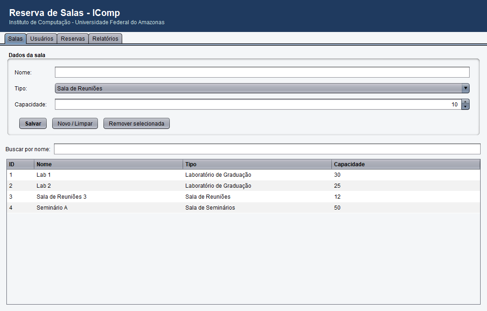

# Reserva de Salas - IComp

Sistema desktop em Java para gerenciar as salas comuns do Instituto de Computação
(salas de reunião, salas de seminário e laboratórios de graduação) e as reservas feitas
por professores e funcionários. Trabalho Prático I da disciplina de Programação Orientada a Objetos (UFAM).

## Funcionalidades

- **Salas**: cadastro, alteração, remoção e consulta por nome.
- **Usuários**: cadastro, alteração, remoção e consulta (professores e funcionários).
- **Reservas**: reserva de sala em data e horário, com bloqueio automático de conflitos de horário,
  listagem e cancelamento.
- **Relatórios**: agenda de uma sala por período, para impressão e afixação na porta.

## Tecnologias

- Java 17 ou superior (testado com JDK 21)
- Swing (interface gráfica)
- SQLite via JDBC (`sqlite-jdbc`), com o banco criado automaticamente em `salas.db`
- SLF4J (dependência do driver SQLite)

## Estrutura do projeto

```
src/
  modelo/     Sala, Usuario, Reserva e enums (TipoSala, TipoUsuario)
  dao/        ConexaoBD e DAOs (acesso às tabelas)
  servico/    ReservaService (regras de negócio, conflitos de horário)
  relatorio/  RelatorioPorta (texto do relatório de porta)
  gui/        Janela principal, painéis e ponto de entrada (Main)
lib/          Drivers JDBC e SLF4J necessários para executar
```

## Dependências (pasta `lib/`)

Baixe os seguintes arquivos e coloque-os em `lib/`:

- `sqlite-jdbc-3.46.0.0.jar`
- `slf4j-api-2.0.16.jar`
- `slf4j-nop-2.0.16.jar`

## Como compilar

No PowerShell, a partir da pasta do projeto:

```powershell
$libs = "lib\sqlite-jdbc-3.46.0.0.jar;lib\slf4j-api-2.0.16.jar;lib\slf4j-nop-2.0.16.jar"
javac -encoding UTF-8 -d out -cp $libs (Get-ChildItem -Recurse src -Filter *.java | ForEach-Object FullName)
```

## Como executar

```powershell
java -cp "$libs;out" gui.Main
```

Na primeira execução é criado o arquivo `salas.db` na pasta de onde o programa foi iniciado.

## Apresentação

A apresentação do trabalho está em `apresentacao/TP1-Apresentacao.pptx` (editável) e
`apresentacao/TP1-Apresentacao.pdf`. As capturas de tela ficam em `apresentacao/capturas/`.



## Gerar a documentação (Javadoc)

```powershell
javadoc -encoding UTF-8 -charset UTF-8 -d doc -cp $libs -sourcepath src -subpackages dao modelo servico relatorio gui
```

A documentação HTML fica em `doc/index.html`.
